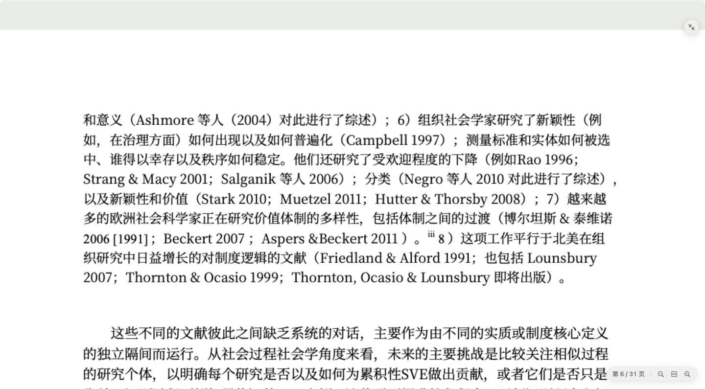
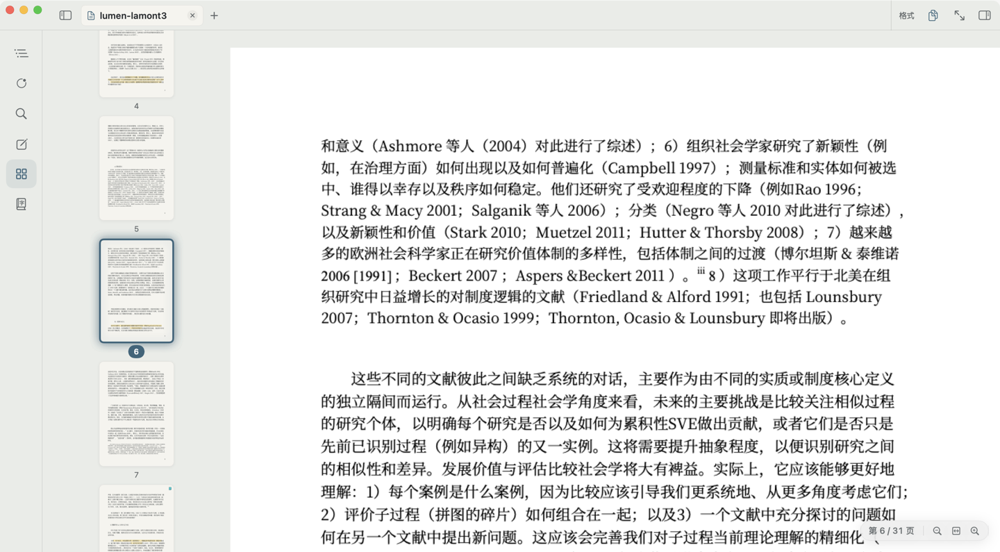
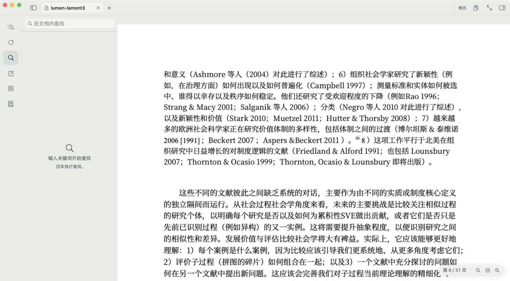
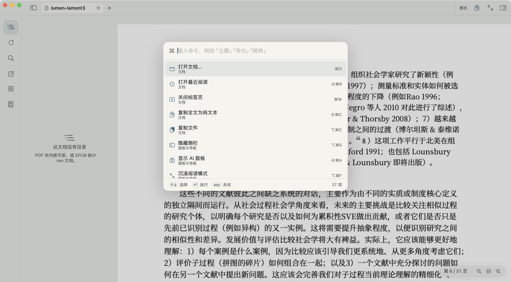

<div align="center">


# Lumen · 流明

**面向文献阅读的 macOS 原生 PDF / EPUB AI阅读器**

[下载最新版本](https://github.com/JiongN/LumenReader/releases) · [源码构建](#源码构建) · [数据与隐私](#数据与隐私)

SwiftUI · PDFKit · WebKit · 零第三方依赖

**本项目由 AI 开发完成**

</div>

---

## Lumen · 流明

Lumen，拉丁语意为「光」。

在现代科学中，lumen 是光通量的单位——衡量真正抵达人眼、被人感知的光。

我们喜欢它，是因为阅读也是如此。

文字可以很多，信息可以无限，但阅读真正发生的时刻，是其中一些东西终于被看见、被理解，与已有的思想连接起来。

中文名「流明」原本是 Lumen 的音译。我们愿意赋予它另一层含义：

**流，是文字、知识与思想的流动。**
**明，是看见，也是理解。**

中国人很早就把「明」用于描述一种超越视觉的理解。《大学》言「在明明德」，《老子》言「自知者明」。

而朱熹写读书：

> 天光云影共徘徊，
> 为有源头活水来。

光与流水相遇，方有清明。

在 Lumen 里，AI 也只是这束光的一部分。

它不替你得出结论，也不试图成为阅读的中心。它做的是解释晦涩之处，连接散落的线索，引入新的背景与视角，让原本停滞的理解重新流动起来。

**好的产品，不该让 AI 代替思考。**
**它更像一束启蒙之光，让人看见更多，也留下继续追问的余地。**

Lumen，让理解继续流动。

---

## 功能

### 沉浸阅读

PDF 原生渲染与 EPUB 章节排版，浅色纸面与深夜主题，阅读时不被打扰。

- PDF：连续滚动、适宽适配、页间留白可调；EPUB：字体、字号、行距、对齐由你做主
- 新建阅读窗口默认铺满当前桌面的可用宽度与高度，避开菜单栏和 Dock
- 双击顶部工具栏空白处可在适应桌面与原窗口大小之间切换；左侧面板可拖宽，窄窗口自动为正文保留空间
- 沉浸模式：面板全收，正文居中限宽，只剩你和文字
- 多标签与独立窗口，多本书并行不乱




### AI 伴读（BYOK）

接入你自己的 OpenAI 兼容接口（DeepSeek、OpenAI、Kimi、智谱、通义，或本机 Ollama / LM Studio）。没有自建账号，没有中转服务器，密钥只存在本机。

- 划词工具栏：解释送入 AI；划词译统一在左侧翻译栏显示
- 当前页 / 当前章问答，模型先读到你读到的地方
- 全文分层摘要与智能目录：逐块覆盖可提取全文，超长文档复用分层摘要
- 图表解读：可选应用技能，取得关联页图后交给视觉模型；需在 AI 设置里选支持图片的已配置服务
- 超预算全文问题保留章节结构摘要，再检索并补读相关原文；摘要不冒充逐字证据
- AI 设置按对话、LLM 翻译、识图分别选择服务商和模型，共用服务地址与密钥；支持搜索模型列表或手填 ID，切换用途互不覆盖。另可配置 embedding 检索、Mistral OCR 和微软官方 Translator
- 全局会话：多本文档共用一份对话，引用可跳回原文核对
- 导出仅保留 Markdown 对话记录，包含材料来源与引用
- 阅读方式：统一阅读指令、可选应用技能与联网设置；“原文依据”默认关闭，勾选后提供核验过的跳转与临时高亮。旧提示词技能迁入阅读指令并归档原定义
- 可选联网学术检索：Crossref、OpenAlex、arXiv；中文问题生成英文主题词，命中不足时用核心词及中文词扩展。OpenAlex 可配置独立 Key
- AI 回复与译文字号分别在面板的字号按钮调整（11–28 pt），也可在设置中调整；不会重新发送请求


### 批注与导航

高亮、便签、页面批注——**PDF 批注直接写回原文件**，其他阅读器里依然可见。普通批注均在后台保存，连续改色合并写入；成功不弹通知，失败仍提示，退出前会等待在途写入。会话编码与原子保存也在后台串行执行，快速更新合并为最新快照。

- 高亮锚回原文，可选颜色并可对已有高亮换色；锚不上时退回页面便签，绝不静默丢失
- 批注清单按页分组，点击定位，可编辑可删除
- 目录、缩略图、全文搜索、页面跳转，四个页签各司其职
- 复制全文直接开始提取，快速完成不弹进度；超过 350 ms 才显示可取消的进度，进度更新合并。扫描件仍先确认 OCR 写回，缺页与失败仍提示






### 翻译与 OCR

- PDF 逐段对照翻译：单击译文定位原文，拖选或双击可选择文字；保留独立复制按钮
- 复杂侧栏和表格页可复用已配置的增强解析；普通文字页直接读取，解析失败保留本机结果并说明原因
- EPUB 逐段翻译：译文嵌入正文流
- PDF 范围可选全部页、当前页、自选页码或划词译；PDF/EPUB 划词模式中拖选原文即在左栏显示原文与译文，不提取整本书
- 引擎可选：必应免密钥直用，或 Apple 系统翻译（可下载离线语言包）
- Apple 翻译先根据正文确定源语言，避免短词和表格单元格反复触发自动语言选择；语言包下载提示仍由系统管理
- 扫描件：本机 Vision OCR，识别后默认将不可见文字层写入原 PDF；重开或清理提取缓存后仍可搜索、复制和提问。全文识别支持取消续跑，整书完成后只保存一次

### 文献图谱

「参考／被引／相关」是单选关系页：左侧文献列表和中央画布同步切换，按当前论文出发的关系方向展示。OpenAlex 论文可按需查询关系；已关联知网的论文通过「知网图谱」读取网站实际返回的数据。

左侧工具栏的「文献图谱」以当前论文为起点，在中央区域探索参考文献、被引文献和相关文献。先核对标题、作者、年份与 DOI，再选择对应数据库题录；点击节点可以继续展开，顶部「返回原文」恢复阅读位置。实线箭头表示引用方向，虚线表示数据库提供的主题相关或相似推荐，不代表直接引用。

元信息按 PDF 前两页版式提取：识别摘要前标题区，合并跨行中文题名与副标题，区分作者和单位；不再默认取第一条长文本或盲信内嵌标题。没有可靠标题时退回文件名并标记待核对，此步骤不自动 OCR、渲染或上传。已有人工修订、知网采用结果和已建立图谱不被自动覆盖；「按首页版式重新识别」和「AI 识别首页」先生成待核对草稿，保存后才替换题录。扫描件需先完成文字识别。图谱按文档保存在应用数据目录，打开文献默认进入阅读模式。

中文 PDF 可点击「提取文内参考文献」，按末尾页面的分栏顺序建立本地引用关系，识别题名、作者、出版年份和来源；同书的多个编号合为一条，跨页续行排除重复页眉和已识别脚注，不再只取前 20 条。原始题录保留在详情中供选择、复制和核对；不支持或损坏的格式不猜补字段。旧的未核对本地记录在打开图谱后后台升级，人工确认的题录不被覆盖。选中本地引文后可编辑搜索标题、查找并核对 OpenAlex 候选；确认后保留原 PDF 引用关系，并可继续展开该论文。文献信息页默认展示可阅读的题录，编辑、信息补全和数据源配置按需展开。

「知网图谱」按需打开应用内可见浏览器。已有知网地址时直接定位；否则自动检索题名，只在题名、作者、年份唯一匹配时进入论文。程序自动定位页面实际提供的引文网络入口，并读取该页面返回的参考、被引和相似论文，导入现有画布。边分别标记 CNKI 来源，推荐不冒充引用；单类最多 50 篇、总图仍最多 150 篇，缺失分类和部分批次明确标示，不声称取得全库网络。导入成功自动返回应用内图谱；没有有效数据时保留官网图谱页面，不生成假空图谱。网站未提供入口、登录或验证码阻塞时仍可能无法直达，不能承诺离线取得知网关系。

在应用内完成验证后，「读取当前页」会继续读取当前论文关系，不重新加载页面或丢弃已观察的响应；题名核对仍保留，显式停止后不会继续图谱任务。

中文文献不只支持文内参考文献：“被引”和“相关”依赖数据库实际返回的数据。当前论文即使保留本地节点 ID，只要已关联知网题录，刷新及继续扩展也会走知网，不再误作未匹配的本地引文；题录原页入口保留。缺失关系不会被标成零篇，不将相似推荐当作被引事实。

「知网题录检索」保留独立关键词查询、最近检索词、题录原页和确认采用。固定 28 pt 的原生单行检索框支持长题名横向编辑及中文输入法，结果页最多 20 篇。采用题录会重建当前论文的图谱匹配，不修改原文或批注。登录、机构访问和验证码由用户在网页中完成，正常验证 HTTPS 证书，不导入其他浏览器或 MCP 的 Cookie；关闭窗口释放浏览器。关系读取依赖网站当前返回，不是正式的开放 API 服务，也不表示取得全文；当前不自动下载、付费或启动常驻浏览器服务，不把交互窗口作为 AI 的无人值守联网源。万方数据库引文 API 仍未接入。

题录浏览只用一个窗口：详情、新标签链接和网页弹窗请求在现有页面内导航，前进、后退返回之前的页面；采用题录改为窗口内确认，不再叠加确认弹窗。工作区移除常驻操作说明、图谱重复计数和生成耗时文案，保留题录来源、错误及覆盖缺口。

新增批注默认使用柔和的马卡龙色；已有 PDF 批注保持原色。

图谱采用文献列表、中央画布、论文详情三栏；窄窗口把详情放到画布下方。左侧直接显示文献与关系筛选，识别和数据源设置可按需展开。关系页签和文献行整块可点击，默认自动适应画布，节点旁不显示截断标题。点击节点会静态高亮对应列表项并直接定位到它，点击列表项则突出节点、关系线并打开完整题录；可拖动节点调整位置、拖动空白处平移画布，手动位置按文档保存。图谱没有入场、脉冲、悬停或列表滚动动画，拖动和缩放仅跟随用户操作。节点大小按当前可见论文的 OpenAlex 被引量作对数映射，并随画布缩放保持可辨认，颜色反映发表年份；顶部显示设置可切换为统一大小或按关系类型着色。被引量与年份缺失的本地引文采用中性色，不用猜测值补齐。OpenAlex API Key 可在图谱左侧顶部或 AI 设置中填写，遇到限流后保存 Key 并点击「刷新图谱」。


### 键盘优先

- 命令面板（⌘K）覆盖全部动作
- 快捷键全部可自定义，冲突一目了然
- 侧栏页签 ⌘1–⌘6：目录、智能目录、搜索、批注、页面、翻译



## 下载与运行

已发布版本见 [GitHub Releases](https://github.com/JiongN/LumenReader/releases)。要求 **macOS 15 或更新版本**。发布包按构建机器的架构生成；当前为 **Apple Silicon / arm64**，不是通用二进制。

解压 ZIP 后将 `Lumen.app` 放入「应用程序」。应用使用自签签名，**未做 Apple 公证**；首次打开需「右键 → 打开」并在系统「隐私与安全性」中允许一次。应用内置「检查更新」（设置 → 关于），有新版本时给出版本说明与下载链接，不会自动覆盖安装。

## 源码构建

需要 Apple Command Line Tools（Swift 6 工具链）；没有第三方 Swift 包依赖。

```bash
./build.sh                 # Debug → dist/Lumen.app
./build.sh release         # Release → dist/Lumen.app
./build.sh debug run       # 构建并启动
swift test --disable-sandbox
./publish.sh v1.1.0 --no-upload  # 仅本地打包，不创建或推送 tag
```

打包版本必须与 `Resources/Info.plist` 一致。`--disable-sandbox` 用于兼容本项目的 SwiftPM 构建环境。对外发布的前提与命令见 [发布说明](docs/RELEASING.md)。

构建默认并发 2 项，以控制小内存设备的优化编译占用；可用 `LUMEN_BUILD_JOBS=4 ./build.sh release` 显式调整。

## 项目目录

| 目录 | 职责 | 是否可清理 |
| --- | --- | --- |
| `Sources/LumenKit/` | 文档解析、存储、AI、OCR 等核心能力 | 保留源码 |
| `Sources/LumenApp/` | macOS 窗口、阅读控制器、SwiftUI、诊断入口 | 保留源码 |
| `Tests/` | 核心与会话数据回归测试 | 保留 |
| `Resources/` | Info.plist、正式应用图标 | 保留 |
| `branding/` | 图标 SVG 与生成工具 | 保留原始设计 |
| `tools/` | 测试素材、模拟 AI 服务及验证工具 | 保留 |
| `docs/` | 当前架构、操作、验证和审计文档 | 保留 |
| `docs/images/` | README 与文档用图 | 保留 |
| `docs/verification/` | 本地验证截图、日志、测试素材 | 可再生；不入 Git |
| `dist/` | 最近一次组装好的应用 | 可重新构建 |
| `releases/<版本>/` | 集中分发的 ZIP/可选 DMG、校验和、构建信息 | 正式发布成果，保留；不入 Git |
| `.build/`、`build/` | SwiftPM 缓存、图标中间产物 | 可再生 |

`./build.sh clean` 只清 `.build/` 与 `dist/`，不删除 `releases/` 或用户数据。

## 数据与隐私

数据位于 `~/Library/Application Support/com.jn.lumen/`，缓存位于 `~/Library/Caches/com.jn.lumen/`。**密钥在 `credentials/` 下以未加密文件保存**，目录权限 0700、文件权限 0600；它不是钥匙串或加密保险箱。共享配置、截图或备份时不要包含凭据目录。旧钥匙串条目不自动读取或删除。可选的 OpenAlex Key 单独保存，仅用于 OpenAlex 请求。

向在线模型提问时，选区、上下文、会话历史或摘要片段会发到所选服务商；联网检索会发送查询，在线翻译会发送待译文本。文献图谱匹配会向 OpenAlex 或 Crossref 发送标题、DOI 等元信息；用户点击知网检索或图谱时会发送检索词/题名并加载论文关系，网页登录状态保存在独立 WebKit 会话中。关系观察只限当前页的三类接口，响应有界且不保存原始网络转储；本地仅保存图谱题录、关系及原页地址。仅在手动点击「AI 识别首页」时，才向已配置的 AI 服务商发送前两页文字中最多 6000 字符。PDF 批注与扫描件 OCR 文字层直接写回原文件；OCR 在本机执行，写回先校验临时文件再原子替换。页面外观保持，文件大小可能增加。加密、签名、无写入权限或原有文字层异常时保留 OCR 缓存并说明未写回。损坏的 JSON 会先保留 `.corrupt-*` 文件供恢复。

## 文档入口与已知限制

- [架构与数据流](docs/ARCHITECTURE.md)
- [验证与复现](docs/VERIFY.md)
- [发布与目录维护](docs/RELEASING.md)
- [维护约束](AGENTS.md)

大型 PDF 批注达到 64 MiB 后改用独立 `LumenPDFWorker` 写临时副本，父进程负责版本核对与原子替换；仍会重写整份 PDF，真实触控板性能验收尚未完成。完整 PDFView/WKWebView 最多保活最近两个标签，更早的标签切回时会重建阅读视图。EPUB 暂不支持 ZIP64、分卷、加密、符号链接及解包总量超过 512 MB 的包。PDF 为固定版式，EPUB 字体与行距设置不会重排 PDF。全局会话可混合多本文档，引用跳转会核对来源；切换文档不创建新会话，但会停止未完成回答。全文提问和总结在容量允许时提供完整材料，超预算时覆盖全部取得的文本并复用分层摘要、补读相关原文；界面显示实际覆盖范围，不把摘要当作逐字全文。上下文容量在 AI 服务商设置中可调整，默认保守值 32768 并非自动识别的模型能力。

PDF 翻译、问答、总结与智能目录共用按文件和解析器版本失效的本地结构缓存。指定 Nature 双栏论文已验证左右栏、摘要、Glossary、Box 和图注保留；任意复杂杂志版式、跨栏表格和图片内文字仍需核对。提取与抽样 OCR 在后台独立文档实例执行，不在滚动回调运行。超预算全文问答按章节或明确页段分配摘要预算，每段独立保存，不再反复压缩混合摘要；容量不足明确失败，不悄悄删章。图表图片只在启用图表技能或选择区域解读时发送给配置的视觉服务；费用和图片支持由服务商决定。详见 [架构](docs/ARCHITECTURE.md) 与 [验证](docs/VERIFY.md)。
