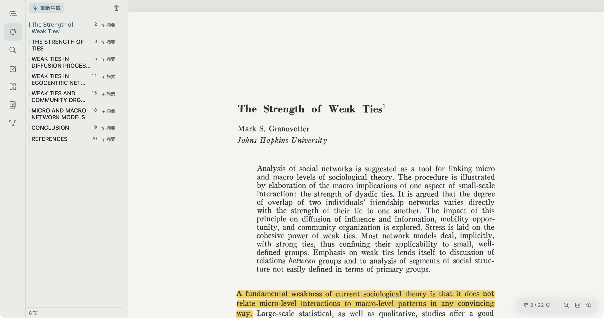
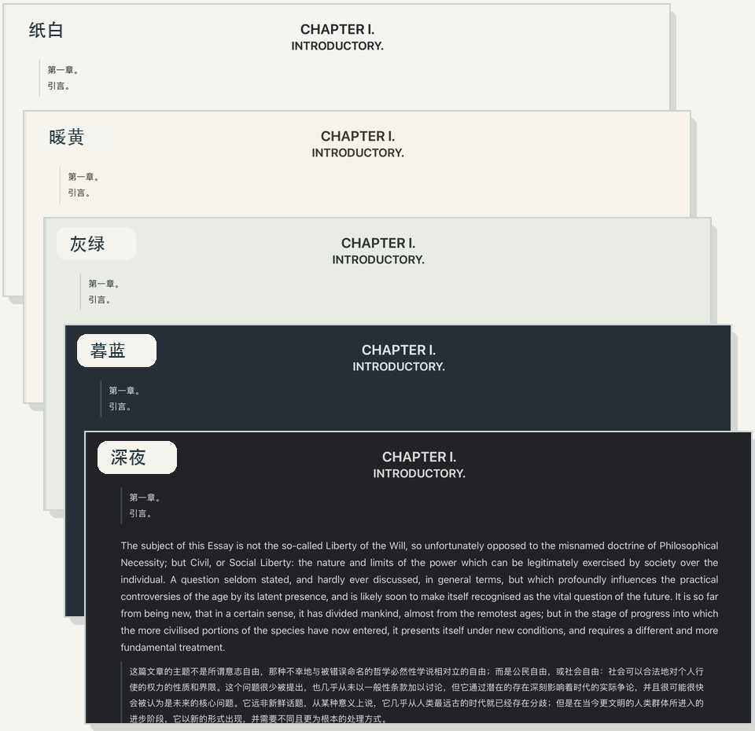
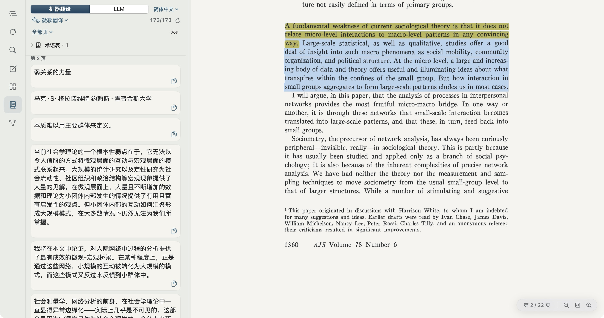
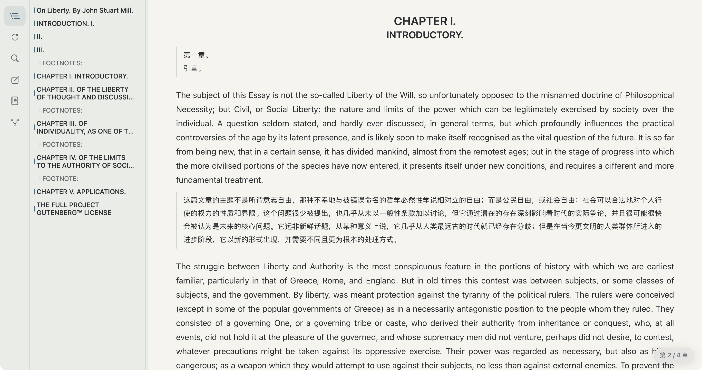
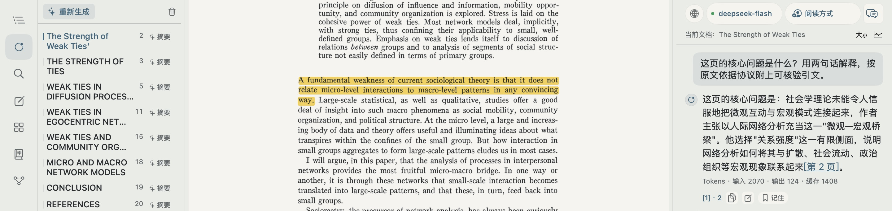
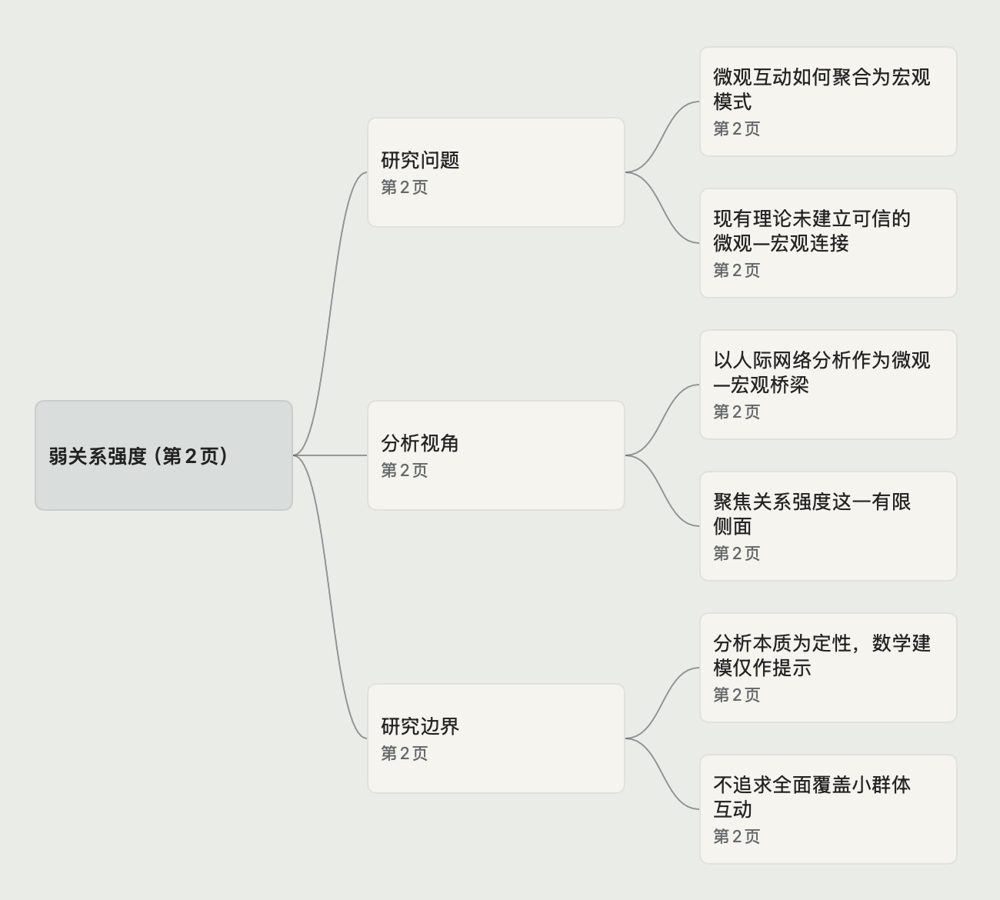
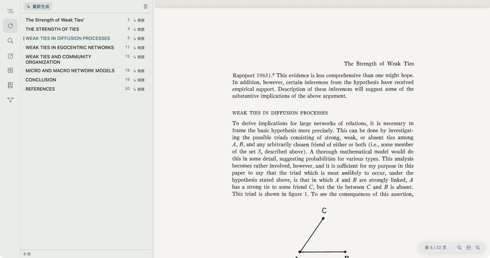
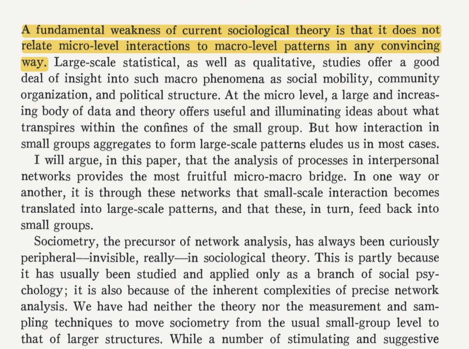

<div align="center">


# Lumen · 流明

**原生 macOS PDF / EPUB 阅读器，支持翻译、AI 伴读和文献整理。**

[下载](https://github.com/JiongN/LumenReader/releases) · [功能](#功能) · [源码构建](#源码构建) · [数据与隐私](#数据与隐私)

SwiftUI · PDFKit · WebKit · 代码由 AI 开发完成

</div>

## 为什么做它

我是文科生，最初只是想给自己做一个读文献顺手的小工具。用 Zotero 读 PDF 有时会卡，其他阅读器有想要的功能，但订阅对我来说有些贵。平时已经在用 AI 会员，就试着把自己的需求一点点交给它，边用边改。

Lumen 支持 PDF 和 EPUB，主要按我自己的阅读习惯做。代码由 AI 编写，肯定还会有 Bug；如果遇到问题、觉得哪里别扭，欢迎在 [Issues](https://github.com/JiongN/LumenReader/issues) 里告诉我，也欢迎帮忙改进。

软件免费，源码公开。开发用的 AI 会员与运行时调用分开：在线 AI 需要自行配置接口，费用按所选服务商计算；也可以配置本机兼容服务。

> 下方截图与功能总览来自当前开发版。最新界面和部分修订尚未打入公开安装包，下载版以 [Releases](https://github.com/JiongN/LumenReader/releases) 的实际版本为准。



## 功能

### PDF 与 EPUB 阅读

- PDF 原生渲染，EPUB 支持字体、字号、行距和对齐调整。
- 多标签、独立窗口、沉浸模式；左右面板可收起和调整宽度。
- 纸白、暖黄、灰绿、暮蓝、深夜五套阅读配色。



### 翻译与原文对照

- 全文翻译、按页或章翻译、自选 PDF 页码、划词翻译。
- PDF 点击译文定位并选中对应原文，复制译文与原文核对都在同一窗口完成。
- EPUB 译文放在正文里，逐段对照阅读。
- 可选机器翻译或自配 AI；Apple 系统翻译可使用已下载的语言包，在线引擎会发送待译内容。





### AI 伴读与原文依据

- 问当前页、当前章或全文，也能继续追问、生成摘要、解读图表和整理思维导图。
- 自定义阅读方式；对话、翻译和识图可分别选择服务商与模型。
- 启用「原文依据」后，可点击已核验的引文页码返回原文。能定位出处不代表 AI 的判断一定正确。
- 跨文档对照、全局会话与记忆，支持 Markdown 对话导出。
- 可选 Crossref、OpenAlex、arXiv 联网学术检索。长文档按实际上下文预算组织材料，缺失或超出能力时提示，不把摘要冒充逐字全文。





### 目录、搜索与批注

- 生成目录、分节摘要，保留原有目录、全文搜索、PDF 缩略图及页码跳转。
- 智能目录从原文标题候选生成，PDF 跳转绑定物理页，EPUB 使用章节锚点；扫描件需先有可用文字层。AI 仍可能漏选标题。
- 多色圆角高亮、便签和页面批注，批注清单里点击定位。
- **PDF 批注直接写回原文件**，其他阅读器也能看到；EPUB 批注保存在应用数据目录。
- 本机 OCR 可把扫描件文字层保存回 PDF，随后搜索、复制和提问。





### 文献图谱与知网入口

- 提取文内参考文献，查看「参考」「被引」「相关」三类关系，点击节点继续探索。
- 先核对标题、作者、年份和 DOI，再采用对应数据库题录。数据库中的相似推荐不冒充引用事实。
- 提供知网题录检索与图谱入口。能取得什么数据取决于网站实际返回、登录和机构权限；不表示取得全文，不自动付费下载。
- 图谱、思维导图和 AI 归纳都需要自己核对，不能代替阅读原文。


### 键盘操作

命令面板（⌘K）与自定义快捷键覆盖主要动作；侧栏可在目录、智能目录、搜索、批注、页面和翻译之间切换。

## 下载与首次打开

当前公开安装包面向 **Apple Silicon / M 系列 Mac，macOS 15 及以上**。

1. 在 [Releases](https://github.com/JiongN/LumenReader/releases) 下载 ZIP。
2. 解压后，把 `Lumen.app` 拖入「应用程序」。
3. 先尝试打开一次。应用没有 Apple Developer ID 公证；如果提示无法验证开发者，确认来自本仓库后，进入「系统设置 → 隐私与安全性」，找到 Lumen，选择「仍要打开」并确认。

若提示文件损坏或会损坏电脑，先停止并反馈，不把不同警告当作同一情况处理。首次打开操作参考 [Apple 官方说明](https://support.apple.com/zh-cn/102445)。安装支持应用内更新的版本后，可用「Lumen → 检查更新」下载并重启更新；也会每天在后台检查正式版，可在设置中关闭。安装前核验 GitHub 校验值、应用版本和现有签名证书，等待批注与会话保存后再替换，保留上一版备份。当前公开旧版仍需先手动安装一次含此功能的新版本。

## 源码构建

需要 Apple Command Line Tools（Swift 6 工具链）；没有第三方 Swift 包依赖。

```bash
./build.sh                 # Debug → dist/Lumen.app
./build.sh release         # Release → dist/Lumen.app
./build.sh debug run       # 构建并启动
swift test --disable-sandbox
./publish.sh v1.1.0 --no-upload  # 仅本地打包，不创建或推送 tag
```

打包版本必须与 `Resources/Info.plist` 一致。`--disable-sandbox` 用于兼容本项目的 SwiftPM 构建环境。对外发布的前提与命令见 [发布说明](docs/RELEASING.md)。

构建默认并发 2 项，以控制小内存设备的优化编译占用；可用 `LUMEN_BUILD_JOBS=4 ./build.sh release` 显式调整。

## 项目目录

| 目录 | 职责 | 是否可清理 |
| --- | --- | --- |
| `Sources/LumenKit/` | 文档解析、存储、AI、OCR 等核心能力 | 保留源码 |
| `Sources/LumenApp/` | macOS 窗口、阅读控制器、SwiftUI、诊断入口 | 保留源码 |
| `Tests/` | 核心与会话数据回归测试 | 保留 |
| `Resources/` | Info.plist、正式应用图标 | 保留 |
| `branding/` | 图标 SVG 与生成工具 | 保留原始设计 |
| `tools/` | 测试素材、模拟 AI 服务及验证工具 | 保留 |
| `docs/` | 当前架构、操作、验证和审计文档 | 保留 |
| `docs/images/` | README 与文档用图 | 保留 |
| `docs/verification/` | 本地验证截图、日志、测试素材 | 可再生；不入 Git |
| `dist/` | 最近一次组装好的应用 | 可重新构建 |
| `releases/<版本>/` | 集中分发的 ZIP/可选 DMG、校验和、构建信息 | 正式发布成果，保留；不入 Git |
| `.build/`、`build/` | SwiftPM 缓存、图标中间产物 | 可再生 |

`./build.sh clean` 只清 `.build/` 与 `dist/`，不删除 `releases/` 或用户数据。

## 数据与隐私

数据位于 `~/Library/Application Support/com.jn.lumen/`，缓存位于 `~/Library/Caches/com.jn.lumen/`。**密钥在 `credentials/` 下以未加密文件保存**，目录权限 0700、文件权限 0600；它不是钥匙串或加密保险箱。共享配置、截图或备份时不要包含凭据目录。旧钥匙串条目不自动读取或删除。可选的 OpenAlex Key 单独保存，仅用于 OpenAlex 请求。

向在线模型提问时，选区、上下文、会话历史或摘要片段会发到所选服务商；联网检索会发送查询，在线翻译会发送待译文本。文献图谱匹配会向 OpenAlex 或 Crossref 发送标题、DOI 等元信息；用户点击知网检索或图谱时会发送检索词/题名并加载论文关系，网页登录状态保存在独立 WebKit 会话中。关系观察只限当前页的三类接口，响应有界且不保存原始网络转储；本地仅保存图谱题录、关系及原页地址。仅在手动点击「AI 识别首页」时，才向已配置的 AI 服务商发送前两页文字中最多 6000 字符。PDF 批注与扫描件 OCR 文字层直接写回原文件；OCR 在本机执行，写回先校验临时文件再原子替换。页面外观保持，文件大小可能增加。加密、签名、无写入权限或原有文字层异常时保留 OCR 缓存并说明未写回。损坏的 JSON 会先保留 `.corrupt-*` 文件供恢复。

## 文档入口与已知限制

- [架构与数据流](docs/ARCHITECTURE.md)
- [验证与复现](docs/VERIFY.md)
- [发布与目录维护](docs/RELEASING.md)
- [维护约束](AGENTS.md)
- [维护经验与已知边界](docs/LESSONS.md)

大型 PDF 批注达到 64 MiB 后改用独立 `LumenPDFWorker` 写临时副本，父进程负责版本核对与原子替换；仍会重写整份 PDF，真实触控板性能验收尚未完成。完整 PDFView/WKWebView 最多保活最近两个标签，更早的标签切回时会重建阅读视图。EPUB 暂不支持 ZIP64、分卷、加密、符号链接及解包总量超过 512 MB 的包。PDF 为固定版式，EPUB 字体与行距设置不会重排 PDF。全局会话可混合多本文档，引用跳转会核对来源；切换文档不创建新会话，但会停止未完成回答。全文提问和总结在容量允许时提供完整材料，超预算时覆盖全部取得的文本并复用分层摘要、补读相关原文；界面显示实际覆盖范围，不把摘要当作逐字全文。上下文容量在 AI 服务商设置中可调整，默认保守值 32768 并非自动识别的模型能力。

PDF 翻译、问答、总结与智能目录共用按文件和解析器版本失效的本地结构缓存。指定 Nature 双栏论文已验证左右栏、摘要、Glossary、Box 和图注保留；任意复杂杂志版式、跨栏表格和图片内文字仍需核对。提取与抽样 OCR 在后台独立文档实例执行，不在滚动回调运行。超预算全文问答按章节或明确页段分配摘要预算，每段独立保存，不再反复压缩混合摘要；容量不足明确失败，不悄悄删章。图表图片只在启用图表技能或选择区域解读时发送给配置的视觉服务；费用和图片支持由服务商决定。详见 [架构](docs/ARCHITECTURE.md) 与 [验证](docs/VERIFY.md)。

### 本地候选：Obsidian 文献页同步

支持将 PDF/EPUB 高亮和批注自动更新到同一份文献页，按 Zotero 父条目标识接管既有页，保留个人正文与属性。批注当前单向，属性与阅读笔记可双向编辑；需先关闭 Zotero One 对同目录的自动更新；使用与恢复见 [说明](docs/Obsidian文献页同步.md)。
