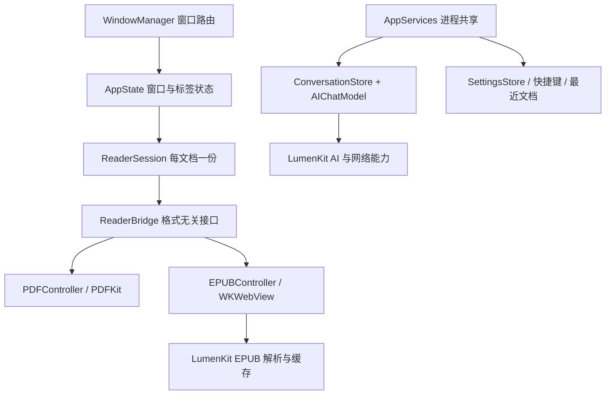

# 系统架构

本文件描述当前实现，冲突时以当前源码为准。过期过程记录已按用户要求清理，规格保留于 design/。

## 分层与所有权

- `LumenKit` 不依赖 SwiftUI，包含文档类型、EPUB、存储、AI 协议、OCR 和纯算法。
- `LumenApp` 管理主线程视图与平台框架桥接；PDFKit 文档和 WKWebView 由各控制器持有。
- PDF 批注解码使用无状态、非 MainActor 的 `PDFAnnotationDecodingDelegate`，允许 PDFKit 的后台 Objective-C 回调；圆角页面覆盖层另由 MainActor 的 `HighlightAppearanceDelegate` 管理。两种代理不可合并为全局主线程隔离类型，避免后台 textExtractionQueue 触发 Swift executor 断言。
- `AppState` 是窗口级；`ReaderSession` 是文档级，持有 bridge、智能目录和文档任务。AI 对话是进程级共享，**不属于每个标签**。
- 文献图谱由 `ReaderSession.literatureGraph` 持有，`LumenKit/Graph` 负责 OpenAlex 查询、关系模型与后台布局。图谱视图只观察这份模型，阅读区的 PDFView/WKWebView 切换时保持挂载；图谱文件保存于 `docs/<路径哈希>/literature-graph.json`。引用与相关边在模型中分别标记，不能混作同一种事实。
- `PaperIdentityExtractor` 在后台仅读前两页、每页最多 200 行原生选区。题名按摘要前位置、正文相对行高及连续标题行选择；摘要已出现的首页优先，第二页正文不能靠异常行高压过题名。区分中文姓名空格、分隔符与单位；拒绝断裂 DOI 的前缀。属性标题不能盲信，未确定时明确回退文件名。旧的自动题录只在没有图谱且来源仍为旧自动识别时升级；人工/CNKI/已匹配数据保留。显式重新识别和 AI 建议暂存在 `suggestedIdentity`，编辑保存后才清除旧图谱；取消或后继操作阻止旧任务回写。没有文字层时不自动 OCR；AI 仅在明确操作后发送最多 6000 字符。
- 知网窗口检索栏使用固定 28 pt 的原生 `NSSearchField`，整行横向编辑，换行归一化；输入法有标记文本时不回写编辑器。窗口与 WebKit 都按需创建，题录准备不进入 PDF 滚动、翻译或 AI 正文渲染路径。“知网图谱”一键定位已有地址或检索唯一一致题录，再定位网站实际引文网络控件；不猜固定图谱 URL。可用关系导入成功后自动返回原生画布，否则保留官网页面并说明阻塞。
- 中文 PDF 的显式参考文献操作由 `PDFReferenceExtractor` 后台只读末尾最多 12 页，找到标题后按原生行的分栏顺序整理，按位置移除重复页眉、页码与同栏底部脚注；可读页不 OCR。`LocalReferenceParser.Entry` 分开原始题录、题名、作者、年份、来源与合并编号，识别 GB 类型标记及跨行续文，最多 149 条。生成 `local:reference:` 节点与来源为「PDF 参考文献」的引用边，`GraphPaper.sourceCitation` 保留原始文字、兼容旧存档。旧生成节点在图谱准备后后台升级，检查取消代际和原快照后才发布，不阻塞阅读会话初始化；重新提取保留已核对题录/节点位置，并按原表顺序替换未核对记录。扫描页仅在此显式操作中可本地 OCR；本地引文按题名、作者、年份及 DOI 检索 OpenAlex，用户确认后替换身份并保留 PDF 引用边。未核对引文不进入远程 ID 扩展路径。
- 知网检索是独立、可见且按需创建的 `WKWebView` 窗口，不是 AI 宿主 MCP 的运行时依赖。`CNKIDOMScript` 参考 cnki-deepsearch 与 cnki-mcp 的实际表单/题录选择器，查询通过 JavaScript 参数传递，在 CNKI HTTPS 主 frame 上执行；不拼接可执行查询、不忽略 TLS 证书、不导入外部 Cookie。`CNKIPage` 限定来源、链接、字段与条数，验证码/登录/未知页面不当作零命中，所有结果固定为 metadata_only。手工读取网页当前页不伪造其检索词。经用户确认只更新 `GraphIdentity`，清除旧候选与选中状态，不将 CNKI URL 交给 OpenAlex 扩展接口。窗口关闭取消在途操作并释放 WebKit；网页持久会话与 EPUB 的非持久离线容器分开。引用选择器的 MIT 许可随 bundle 的 ThirdPartyNotices.txt 分发。
- `CNKIGraphScript` 只在显式图谱操作中注入，观察当前主 frame 实际 fetch/XHR 的三个白名单端点，单响应最多 512 KiB、缓冲按端点覆盖，后台解析为 `CNKIRelationBatch`。根题名与当前页核对、来源/导航/取消代际检查后才能导入；三类各最多 50 篇、图总量最多 150 篇。参考边从当前文献指向被引用者，被引边反向，相似关系是虚线；均带 CNKI 来源，不混用 OpenAlex 被引统计。不读取 Cookie，不直接补发 API，不自动翻完所有页。零命中、缺权限、响应错误、空缓存不等同；缺类和截断批次明确标示。`GraphIdentity.cnkiURL` 可选兼容旧存档，重启复用原页地址；未知/失效地址不能承诺仍可打开。CNKI 节点继续扩展仍走同一按需窗口，不发送给 OpenAlex ID 接口。
- 根论文可能在关联知网后继续保留 `local:current` 身份。`LiteratureGraphModel.cnkiURL(for:)` 核验其已存知网地址，刷新及详情扩展不再误走本地引文匹配或 OpenAlex；未核对的其他本地引文不能继承根论文地址。空缓存只说明尚未取得，不显示虚假的零被引。知网仅观察用户显式打开网页返回的关系，不构造独立授权 API 请求；没有正式接口契约与凭据时不直连两库开放 API。
- 验证/登录暂停后保留 `CNKISearchModel.currentGraphPaper`，显式「读取当前页」沿用已加载页面和观察缓冲继续图谱读取，不重载验证后的原页；新检索或显式停止清除该目标。续读仍检查页面题名、导航、取消代际和来源，不能把不相关页面导入当前文献。题录检索模式的读取行为保持不变。
- 中文数据源的最新可行性与接入条件见 [CHINESE-LITERATURE-GRAPH.md](CHINESE-LITERATURE-GRAPH.md)。万方官方已公开题录检索/详情接口及应用鉴权，但公开目录没有逐篇引文关系接口；知网研学开放平台可见应用审核流程，未核验到可用的引文接口契约。OpenAlex 的中文期刊覆盖和元数据完整度有显著缺口，见[覆盖研究](https://doi.org/10.1007/s11192-026-05664-4)。因此本地引文表只记录 PDF 明确列出的关系，未匹配结果保持未核对状态。
- 图谱尺寸与颜色借鉴 [Connected Papers 图谱图例](https://www.connectedpapers.com/main/fb4f7faa037d8027ea3a46969a8cb76c10406715)：被引量相对当前可见最大值以对数比例映射至 5–24 点半径，发表年份映射低饱和暖色到青色；两项均可在显示菜单改为统一尺寸或关系类型颜色。我们的实线只表示明确引用，虚线才表示 OpenAlex 主题关联，布局不声称表示论文相似度。图谱采用左侧文献列表、中央画布和右侧详情；窄窗口将详情移到画布下方。旧布局缓存按版本重排，手动固定的节点位置保留。布局把参考与施引文献分到起点两侧，已加载节点之间的 `referenced_works` 才补明确引用边；初次进入及图谱扩展后按可见节点边界自动适应画布；节点旁不绘制标题和引线，完整题录从右侧详情或左侧列表读取。
- 图谱与侧栏禁用继承动画事务，不使用入场缩放/渐显、选中脉冲任务、连续悬停状态或列表滚动动画；仅保留静态选中及用户驱动的拖动/缩放。关系页签的尺寸、背景和矩形点击形状在 Button label 内，文献行同样覆盖空白区域，避免只有文字可点。重新挂载时同步当前本地引文的搜索标题，不依赖一次新的选中变化。
- 多标签阅读视图以叠层宿主，但完整 PDFView/WKWebView 只保活最近两个。更早的标签保留会话与落盘位置，再次激活时重建平台视图。关闭标签集中取消文档任务、保存位置和解除 bridge 闭包；迁出为独立窗口不是关闭。

## 主要数据流

工作区保留实际数据、错误和覆盖缺口，不常驻展示操作教程。题录浏览只有一个 WKWebView 窗口：`target=_blank` 与 `window.open` 都复用现有页面，仍校验 HTTPS、升级旧知网地址并拒绝下载；不再持有登录/详情子窗数组。历史按钮观察 WebKit 的前进/后退状态，手动回退取消旧读取任务。替换题录在结果栏内确认，未确认不更新文档身份。

全文复制立即运行提取，只把进度展示延后 350 ms；任务结束/关闭/取消使延迟展示失效。已展示的进度最多每 100 ms 更新一次，快速复制不创建浮层或计算无用成功提示。扫描版仍确认 OCR 写回，缺页与写剪贴板失败仍就地反馈。诊断等待真实提取任务而非进度浮层，避免安静复制被误判为已经结束。

普通 PDF 全文复制由 `PDFTextCopy` 在独立后台任务中重开只读 PDFKit 文档，按原页顺序读取文字层并复用已缓存 OCR，逐页释放临时对象。阅读中的 PDFDocument 不跨执行器，取消不返回部分结果；原文件不再可重开时，保留活文档的逐页让出执行器回退。不启动增强解析或新 OCR，不做全书重排。

网络响应大小与同源重定向策略由 `BoundedResponseData` 统一管理。AI 流式请求沿用有效内容/总时限及输出上限；模型列表上限 2 MiB，学术检索与图谱响应上限 4 MiB，提前失败会取消连接。只接受同协议、主机、有效端口的重定向，跨源和 HTTPS 降级不会携带正文继续请求。API 基址拒绝用户信息、查询参数和片段；错误提示不回显可能夹带凭据的地址。图谱摘要复用学术搜索已有的有界倒排索引解析，避免第二套无上限实现。

AI Markdown 表格以表头和合法分隔行识别，使用原生单元格换行与横向滚动；支持对齐、转义竖线和行内格式。代码块和普通竖线文本不按表格处理。单表最多渲染 12 列/200 行，超出或不合法部分保留为文字，不静默丢弃；复制和导出保留原 Markdown。

AI 对话使用稳定消息 ID 的行外壳和有界绘制：可见区域上下各预取一屏，最近两条保持挂载，其他消息保留已测高度而不绘制正文。这里不再使用 LazyVStack：它在连续提问及末条高度变化时曾留下没有任何消息行的视口。`TranscriptScrollController` 依据 AppKit 实际文档/视口尺寸合并跟随与边界校正，不依赖懒布局估算高度或 SwiftUI 的底部锚点。滚轮、拖动、键盘及辅助功能向上滚动会暂停跟随，回到底部恢复；新末条消息重置跟随。已解析 Markdown 按精确原文在进程内有界缓存（24 项/估算 8 MiB），离屏行重建时恢复排版；未命中先显示实际文字并后台解析。缓存不保存字体、颜色和已核验引用，旧气泡通过完整值比较复用。`--transcript-report 1` 仅打印行与滚动几何，不记录正文；默认不创建探针。实际 NSHostingView 视口回归通过 `LUMEN_RUN_NATIVE_LAYOUT_TESTS=1` 单独运行，不能仅以模型数组不变作为“显示正常”的证据。

每个窗口只挂载一个 AI 面板，保活阅读标签通过布局锚点提供其位置，避免多个隐藏 transcript 同时响应全局流。切换文档/主页不停止全局回答；发起请求时捕获的文档与取材闭包保持不变。停止按钮和切换会话仍取消相应任务。普通正文由 TextKit 原生 NSTextView 排版，连续段落合并为一个文本区，流式只追加后缀；完成后在同一个原生视图应用已解析的标题、列表、行内样式和核验链接，不切回大量 SwiftUI Text。按内容及宽度缓存实测高度，滚动不重复计算未变正文；表格和代码保留独立横向滚动。离屏正文随消息行卸载，旧流式段落渲染器已删除。这不是对任意长回复或系统负载下零停顿的保证。

AI 设置先编辑服务商与凭据，再维护模型目录/参数，最后按用途选模型。增强 OCR 使用固定模型版本与独立逐页缓存；官方 Mistral 旧默认 `mistral-ocr-4-0` 迁移到 `mistral-ocr-4-1`。HTTP 服务故障或连接中断会暂停后续页请求，保留本机证据并说明未完成范围；冷却按服务配置隔离，不回显任意服务端正文。

Apple PDF 翻译每批最多 24 块，批量未返回、空结果或失败的项目只补试一次单项翻译；不缓存缺块译文，单段失败不连带正常段落。不支持的语言和连接故障停止后续请求。Microsoft 共享在途凭证获取，认证失效才刷新；短暂连接或 5xx 故障仅退避重试一次，429 遵守共享冷却，不立即刷新凭证绕过限流。请求超时 20 秒，翻译响应最多 1 MiB、凭证网页最多 8 MiB，表单编码保留原文中的加号。该通道仍依赖 Bing 网页接口，不能承诺服务可用性。

`TranslationSourceResolver` 在后台根据最多 8 个完整段落分别识别、按正文长度投票，单个样本最多 1000 字符；不将多页元数据和正文拼成万字样本（真实 Harris 论文曾被该识别方式误判为法语/捷克语）。划词过短时只补读所在页及最多两个相邻页，不为识别一个词而提取整书。PDF/EPUB 的 Apple 会话使用明确的 source/target，同一语言对通过 invalidate 递增版本；无法确定源语言时就地失败，不启动 source=nil 的系统检测弹框。首次下载语言包等合法系统提示仍保留。

`PDFTranslationMaterial` 将翻译接入共享 `EnhancedDocumentService`：普通文字和对称双栏继续本机读取；大量窄侧栏与正文并排、结构化表格或缺失/异常编码页，在解析开关启用后按所选页范围增强。按块 reading order 转为译文段落、剔除页眉页脚，表格保留空列；归一化图像坐标经 crop/rotation 逆变换回 PDF 坐标。缺少文字坐标、段落 ID 冲突或丢失大段可读正文时保留整页本机结果，不用半页结果覆盖；跨页续段不作局部替换。云端缓存独立于本机 layout 版本，按实际文件指纹、服务和模型保存。准备任务由翻译控制器持有，停止/关闭会取消实际提取与网络任务，旧代际不回写；失败原因在翻译栏显示，不弹成功通知。

PDF 翻译与全文 AI 取材通过 `PDFDocumentContextCache` 共享后台结构缓存，版本绑定文件指纹与解析器；独立 PDFDocument 由串行 actor 持有，滚动热路径不提取。全文请求完整材料优先，超预算时按 PDF 顶层目录/EPUB 章节分段，无 PDF 目录则按明确页段保留全部材料。每片段摘要带固定身份并独立校验、缓存，预算按全体片段分配；不再将混合摘要反复压缩，容量不足明确失败。全文问答、总结、比较和导图均应用这套流程，检索只补充原文，不能替代全书骨架。摘要的范围和长度可以程序验证，语义忠实性仍须人工抽查。

结构块保留段落/表格/图题/页眉页脚、阅读顺序、物理页码、可选印刷页码、归一化坐标和解析器版本。普通提取直接读取 PDFKit 文字层，不再为了抽样验证而先 OCR 三页；仅文字层缺失、明显编码异常，或几乎只有页码且具有整页形状的大幅栅格图像时进入本机 OCR。短标题、正常图题/表题不单独触发 OCR。设置启用时，缺失或仍有异常编码的页才请求固定版 `mistral-ocr-4-1`；没有候选页时在读取密钥、建目录、渲染和网络请求前直接返回。图表图片仍由图表能力按需取得，出现“图 1/表 1”不自动上传解析。某些字体映射乱码不含非法字符，无法在取消抽样 OCR 后自动穷尽识别，可用手动识别兜底。逐页缓存并记录失败页，服务不可用时保持可读原文，不重送整本。原生表格保留行列/跨格单元格，Mistral 原始页 JSON 与块坐标一并保存；不默认下载本地版式模型。

读取全文不等于每个回答必须讨论所有章节。全书总结、概览等综合任务返回隐藏范围声明；缺段或未知段标识视为未验证，不进入后续历史，重复的有效标识不误判为缺段。全书导图还检查分支的 coveredSections，不能只在末尾声称完整。声明通过不证明内容真实，声明错误也不证明正文确实漏章；这是本地校验，不使用 HTTP 错误码。概念核对、具体句子等局部问题不要求逐章回答，但全文材料和超预算分层摘要仍保留。内部声明在流式显示、失败正文、复制、批注和导出中隐藏。文档只在请求稳定前缀中出现一次，历史不重复嵌入全文；兼容无状态接口仍需每轮携带依据，缓存不等于服务端记忆。取消后旧任务不得回写后继会话。

结构缓存当前为 layout-12，补充 PDF 章节范围，段落文字只存一份、解码时重建问答材料和段落坐标。旧版段落几何重新整理，不再直接升级错误分段；尚未写回的旧 OCR 行按不变文件指纹复用，不重复识别。分栏从实际空白边界寻找分隔，支持超出 70% 宽度的窄侧栏；PDFKit 已逻辑去连字符但物理选区仍拆词时，只按原文字符范围证明的连续关系拼回。保留同基线字体合行、栏内自适应行距、保守页边过滤、旋转表格和图注处理。长段在后台按句子切块，原坐标用于定位；翻译模型单独保存于 reader.translationProviderID/translationModel，不随聊天模型切换。PDF 翻译支持全部页、当前页和自选物理页码（包含首尾，界面从 1 起）；范围直接限制提取和 OCR，独立缓存不冒充全文缓存。可复用完整缓存时取范围内段落，边界跨页续段须重新提取所选页，不能丢掉边界文字。

AI 原文依据使用独立 answerEvidence，不将输入材料目录 evidence 当作回答的实际引用。每个本轮原文段落有包含文档身份的原文ID；模型在论断后标 [原文N]，末尾返回短引文与标识。程序仅将本轮实际送出的原文中存在的逐字引文（容许空白差异）转成跳转目标，摘要本身不作为逐字证据。兼容模型误填已提供的章节标识或旧示例 COPY 前缀，但只在指定章节、本轮送出的原文中有唯一匹配时恢复；不存在、歧义、错文档、未提供原文均拒绝。超预算时保留全部片段摘要，并预留空间补充相关或代表性原文。核验通过只证明出处与引文存在，不证明该引文在语义上充分支持论断；没有有效引文不显示可点击依据。旧会话继续读取，但旧材料列表不升级为已核验回答引用。

“原文依据”是按阅读方式勾选的应用能力，默认不启用。仅启用时构造引用协议、核验引文及显示回答依据；重新生成重新读取当前开关，不复用旧协议。无有效证据的 `[原文N]` 在正文隐藏，有效的转换为可点击页/章链接；输入材料目录不作为替代跳转。提示词类旧技能一次性合入所属阅读方式的 persona，原定义留在 retiredReadingSkills。技能库仅保留应用实现的原文依据、图表解读和学术检索；不执行用户提示词中的能力声明。

`D1S13` 等章节身份只供全文覆盖校验，不是用户引用。提示明确禁止在正文显示；显示、复制、导出和批注统一隐藏自然语言中的内部标签，旧会话无需重写也生效。代码示例及导图的 coveredSections 协议数据保留，校验仍读取原始响应，不能靠隐藏标签伪造覆盖成功。未启用原文依据时不追加引用规范；流式正文也不显示尚未核验的原文标记。

依据跳转仅核对文件版本，不再次提取全文；支持打开已关闭的来源标签。PDF 优先在段落涉及的页面中选中短引文，容许跨行空白差异，找不到时临时选中已提供的段落坐标；不创建批注或写盘，也不触发划词工具栏。EPUB 在所属章临时选择匹配文字。文件版本发生变化时旧依据提示重新核对，加入批注同样拒绝使用失效依据；导出保留文档、页/章及引文，隐藏协议注释。

PDF 首次载入不再遍历缩略图页面尺寸；目录延后后台读取，全页几何只在缩略图面板需要时用独立 PDFDocument 获取，关闭面板取消，换文档禁止回写，结果只在滚动停稳后发布。缩略图在保存成功后换版本，避免先读取旧磁盘批注；缩略图私有 PDFDocument 在串行 utility 队列访问和释放。无需恢复的第一页不重复执行 PDFKit 跳页。批注列表按页缓存，预算 4 MB，编辑只使受影响页失效，卸载清空；首次列表读取仍需分批遍历。

普通批注写回在专用串行 utility 队列执行，不占用 Swift 协作执行器；私有 PDFDocument 与批注只在该队列访问，在 autoreleasepool 内释放。连续编辑仍合并快照，已接受的原子写入不因切换文档而丢失，结果禁止回写后继视图。64 MiB 以上文件由 `LumenPDFWorker` 子进程重写临时副本；父进程仍用 NSFileCoordinator、指纹和原子替换提交，helper 无权改原件。PDFKit 仍会重写整个 PDF，不是增量保存，不能承诺大扫描书没有 CPU、磁盘或瞬时停顿；须完成 desk2 真实触控板对照才能判断主线程卡顿是否达标。诊断分别记录 Task 恢复和主队列 DispatchSource 16 ms 计时器延迟，冷启动布局与已就绪阅读窗口分开。旧窗口遇到文件外部变化拒绝覆盖；仅显式核对前后指纹的 OCR 写回允许旧阅读视图继续合并批注。

便签更新/删除同步处理关联 Popup，避免重复保存累积旧正文。PDFKit 有时会落盘无 Parent 的自动 Popup；仅在默认生成几何、正文、日期、颜色全部匹配且唯一时识别，未知或歧义的无主 Popup 保留，不批量删除历史文件内容。外部批注仍保存完整归档并覆盖当前可编辑值、关联 Popup 坐标；重建函数由普通 writer 和 helper 共用，防止归档坐标漂到原点导致保存校验失败。保存校验按逻辑批注而非关联 Popup 重复计数。

图表技能只从本轮匹配的至多四个 PDF 页生成图片，支持用户拖选归一化区域；图片字节作为 OpenAI-compatible image_url 发送，选择配置中的视觉服务，没有配置时使用当前服务并由真实响应判定能力。输出规则区分图面可读数据与推断，不把视觉估值称为计算。精确计算接口和可靠的跨页表格图像定位仍未实现。Anthropic 或其他非 OpenAI-compatible 图像协议尚无单独适配器。

扫描书全文识别在本机 Vision 执行，AI 面板显示页数进度；只在 OCR/异常文字路径保存逐页断点，每十页落盘，正常取消时保存已完成页。重试按同一文件/解析器版本复用，完整快照写成后删除断点。纯文字文件不额外维护逐页缓存；识别位图与页面解析用 autoreleasepool 及时释放临时对象，进度通知限频。共享任务的每位等待者单独订阅进度，旧请求不得回写新会话。读取阶段有独立 30 分钟上限，完成后才启动回答总时限；单次系统 Vision 调用无法立即硬中断，取消会在页边界生效。AI 界面的忙碌不代表 OCR 已调用远端模型。

OCR 默认写回原 PDF：`PDFSearchableWriter` 将 CoreText 不可见文字层叠加到原生页面内容，保留页面框、旋转、批注、元数据及重新绑定的目录/内部链接。中英文字体选用能在 PDFKit 再保存后保持 Unicode 映射的系统字体；每页回读校验文字。仅 OCR 位图缩放，保存不采用页面截图。全文提问、翻译与复制全文共用后台 worker，整书完成后一次写回；单页识别也在后台写回。源文件指纹检查、NSFileCoordinator 和共享提交锁将 OCR/批注的最终校验及替换串行化，文件被更新时拒绝旧写入。写回期间计入退出等待；取消在替换前检查，失败保留原件及 OCR 材料并显示原因。

PDF Keywords 中的 `LumenOCR1:` 记录已处理页，包括无文字页，重新提取时跳过这些页的 Vision 验证；删除 Lumen 结构缓存不导致重做 OCR。旧 OCR 快照会补齐可写回的行坐标，新缓存仅在写回未成功时额外保存 pendingOCRLines。成功后更新文件版本并删除重复行数据。阅读控制器收到写回通知后在滚动停稳且无在途批注保存时刷新文档，保持页码与倍率；可搜索文件的 Lumen 批注从最新独立文档后台保存，避免旧视图覆盖文字层。加密、数字签名、无写入权限及已有异常文字层采用缓存回退，不静默移除保护或光栅化原文。

预算由配置的上下文容量扣除最大输出及至少 10%/1024 token 安全余量，再扣提示、范围标记等开销。默认 32K 是未知模型的保守配置，并非服务商限制。官方 ECNU 端点的 ecnu-max/plus 可由用户明确采用 512K/256K（2026-10-03 官方文档）；预算按所选模型已知上限钳制，避免切换到较小模型后仍使用较大容量。增大容量可能增加输入费用。片段摘要的提示目标采用档位，硬上限利用未取整的分配余量；同一片段最多两次修复，不剪断句子、不删别章。最终材料仍做总预算检查；本地失败不伪装成服务端 HTTP 422。

AI 提问范围仅有当前页/章、全文和双文档，不自动附带选区；划词解释与翻译仍保留。思维导图是一个明确的阅读方式，由普通文本模型输出结构化树，本机渲染为可展开和缩放的原生图形；兼容 mindmap/json 围栏及无围栏 JSON，节点数量与深度受限，格式不合法时保留原回答，不执行模型代码。来源文字仅展示，跳转仍通过验证过的气泡证据。

思维导图展开为独立可调大小/全屏的原生窗口，默认 100%；旧导图技能及提示词型技能归档，阅读要求迁入指令。AI 流有效内容空闲上限 90 秒、每请求总时限 300 秒、整个回答 600 秒，结束标记后最多 2 秒收 usage。正文 128KB、推理 64KB、响应 1MB，后台读取解码；正文和推理统一约 120ms 节流，流式预览不做 Markdown 重排。长会话保留原记录，历史按预算提供至多 12 个完整对子，失败回答不参与；超预算且有足够余量时，ConversationMemoryPlanner 增量整理阶段记录、保留最近对话并检索相关旧记录。阶段记录按历史前缀摘要校验复用，不作为原始证据；预算不足时说明未送出范围。

服务商快捷菜单只切换服务商已配置的 selectedModel；完整模型列表仅在设置中选择。翻译保持自己的模型配置。DeepSeek 官方新版模型明确发送 thinking.type，遵循扩展思考开关；旧 reasoner 及未知网关不假定支持该参数。输出上限始终采用配置，设置可输入数值，不自动加预算或重试收费请求。finish_reason=length 保留部分正文与已收到的 usage，失败回答不进入历史，提示具体模型/预算而非一律要求减少导图节点。

1. 打开路径 → WindowManager → AppState 创建/选择标签 → 阅读视图解析 → bridge 发布位置、目录、选区和能力。
2. AI 请求 → 捕获文档与配置快照 → 可选检索 → SSE 流 → 当前消息 → 完成时持久化。停止会同步结束当前消息；取消任务恢复后禁止刷新、清空或结束后继请求。
3. PDF 批注 → PDFKit annotation。普通批注编辑不再按文件大小分流，均按改动页快照，在独立后台 PDFDocument 中串行写入同目录临时文件，验证后原子替换；连续编辑合并未提交的旧快照。Lumen 编辑只替换自有批注；外部批注编辑保留该页的其他批注并核对来源版本。文档世代号隔离 UI 回调，文件指纹防止覆盖外部改动，退出时等待在途任务。批注 ID 查询仅扫描目标页，列表按页让出主线程；保存完成不再次刷新整个批注列表。高亮按保存的颜色绘制，不调整色相、饱和度或亮度。跳页、搜索定位、翻译定位与文档重载清除旧手势和工具栏，批注点击必须有同一页面、同一文档的有效按下/松开。
4. EPUB → ZIP 中央目录预检 → 可取消串行解包 → 禁止外部 XML 实体 → 校验包内资源路径 → WebKit 加载。解包有 60 秒时限，取消会终止所属子进程，失败清除未完成目录；首次打开复用验证时解析的文档，不重复解析目录。缓存标识包含版本、路径、大小、高精度修改时间与文件编号，不是内容哈希。章节文本用线程安全 NSCache，目标 8 章/16 MiB，可在内存压力下回收；这是缓存目标，不是进程内存硬上限。
5. EPUB 内链按实际章节匹配，跨章时更新控制器状态再加载锚点；外链只允许显式点击的 HTTP/HTTPS/mailto，禁止远端页面替换正文。正文内容 JavaScript 默认禁用；Lumen 自己注入的用户脚本仍可运行。加载前安装 WebKit 内容规则，阻止书内 HTTP(S)/WS(S)/FTP 子资源自动联网，使用非持久网站数据存储；仅在线提供的插图因此不自动显示。批注字符串使用 JSON 编码，避免引号、控制字符破坏脚本。
6. EPUB 翻译→ WebKit 提取当前章可见段落→过滤空白、无字母和已是目标语言的内容→按设置调用 Apple 系统翻译、Microsoft 或 LLM→按索引将译文紧跟写在对应原文下方。段落识别同时覆盖语义标签与出版商常用的叶级 `div/section/article`；译文合并后批量写入 WebKit。章节、引擎、目标语言或术语表变化时会取消旧任务；标签转入后台时也会立即取消，不与前台 PDF 渲染争抢资源。

## 持久化

| 位置 | 内容 |
| --- | --- |
| `settings.json` | 界面、阅读、模型与 Agent 配置，不含 API 密钥 |
| `credentials/*.key` | 本机密钥，0700/0600 权限，未加密 |
| `conversations.json` | 所有窗口共享的历史与活动会话 |
| `recent.json` / `keybindings.json` / `memory.json` | 最近文档、快捷键、记忆 |
| `docs/<路径哈希>/` | 阅读位置、EPUB 批注、智能目录、翻译缓存 |
| `docs/<路径哈希>/literature-graph.json` | 本地识别修订、已确认论文、图谱节点与布局；文件变化时重建 |
| 系统 Cache 目录下 `epub/` | 解包后的 EPUB，可再生 |

缺少兼容字段可回落默认值，正文或消息集合类型错误必须抛出并触发损坏备份，不能默默变空后覆盖。备份改名失败时本进程禁止通过 `PersistFile.write` 覆盖原路径并在启动窗口提示用户检查权限或空间；本次运行的相关改动可能无法保存。路径哈希不是内容标识，移动文件后不会自动找回原路径下的状态。

会话内相同的引用列表只落盘一份 evidenceCatalog，解码时恢复各条回答，旧格式兼容读取；移除仓库中无人读取的历史副本。长文本估算、分块、倒排索引和旧对话检索在 utility 任务执行。分层摘要、跨语言查询词及增强解析结果保存在 `Application Support/document-analysis`，不因时间自动删掉可能产生费用的结果；内存副本最多约 2 MB。可再生 embedding 向量与 `Application Support` 分开，存于 `Caches/document-embeddings`，上限 128 MB、180 天，淘汰后可重建。PDF 结构缓存内存最多 2 份/32 MB 文本，磁盘 128 MB/30 天，每 5 分钟最多检查一次。仅清理明确可重建的摘要旧缓存与 document-context*.json；批注、译文、会话、凭据和损坏备份不自动删除。旧自由压缩摘要不再复用。

可再生 PDF 断点 document-context-progress.json 同样纳入 128MB/30 天政策，当前文件保护。LUMEN_TEST_DATA 无条件显式隔离；Swift Testing 的 PackageTests 执行文件即使无环境变量、无 .xctest 后缀，也自动使用独立临时目录，禁止测试写入正式用户会话。

## UI 与功能入口

`ActionEntries` 统一部分菜单的职责与可用性；`LumenAction` 统一菜单、命令面板和快捷键。磁盘导出归文件菜单，剪贴板操作归复制入口，会话管理归 AI 头部会话菜单。PDF 与 EPUB 的对照翻译共用左侧工具栏的翻译标签，格式弹窗只保留阅读外观。仍须检查真实视图是否绕过规划表手写重复入口。

左侧宽度偏好允许 200–1000，实际显示仍受三栏预算和布局倍率约束，窄窗口不覆盖保存的宽度。顶栏固定 40 pt，交通灯与按钮垂直对齐；空白区域保留原生拖窗，双击按当前屏幕 visibleFrame 适应宽高并可还原，不切换桌面。窗口适应复用 PDF 面板调整的阅读锚点保护，在新容器尺寸布局后恢复，避免原生适宽时阅读位置漂移。AI/译文字号独立保存在 UISettings（默认 15 pt，11–28），缺失或坏字段回落默认；字号不进入请求身份，EPUB 译文仅更新 CSS。

PDF/EPUB 划词译共用 ReaderBridge 中的模式开关，浮动工具栏与翻译范围菜单一致，不创建 AI 会话请求。仅接受已结束的真实用户选区，300 ms 防抖后直接准备所选文字，不打开后台文档或执行 OCR；程序化引用与翻页选区不触发。缓存仍核对文件、文本摘要、引擎与语言。切换选区或离开面板取消旧队列，旧完成回调不得清除新任务。PDF 译文由轻量 TextKit 视图显示，不包在整行 Button 中；单击定位，拖选、双击、修饰键及复制不触发跳转，独立复制按钮保留。PDF/EPUB 共用系统翻译配置刷新：相同语言在上一配置上递增版本，避免每次新建配置后 invalidate 得到相同版本而漏掉后续请求。

主题来自 `ReadingTheme` / `DesignTokens`，动画经 `MotionGate`，左右面板拖动按 12Hz 节拍合并即时宽度、结束后保存。分隔线有 12pt 的实际布局命中区，宽度预算会扣除两侧分隔线；PDF 面板拖动和显隐期间暂停 `autoScales`、钉住倍率，结束后恢复缩放模式与纵向阅读锚点；手动倍率按新可用宽度调整并限制页面宽度、横向居中，避免适宽按钮或手动缩放后的旧倍率造成裁切。缩放通过内部 NSClipView 恢复锚点，不修改 PDFView 自身坐标原点。PDF 保持原生 tile 绘制；主题通过固定视口叠层着色，不写入原文件，也不对整个 PDF 阅读面做离屏合成。macOS 26 在载入前关闭 PDFKit 自动文档分析，避免可见页变化触发后台 Vision 识别；应用的手动 OCR 独立保留。该兼容处理使用非公开运行时接口，系统升级必须复验，见 [滚动修复记录](PDF-SCROLL-20260922.md)。左右面板均可拖动，窄窗口优先保留阅读区宽度。三栏预算由外层 GeometryReader 读取父容器的可用宽度，不能测量 HStack 自身撑出的宽度再反馈到预算，否则窗口收窄会形成宽度反馈并使面板越界。

## 工程取舍

SwiftPM 零第三方包依赖，两个产品目标均以 Swift 6 语言模式构建。审计代码与应用同目标编译便于原生框架验证，但会增大维护面；后续可逐步迁入 App 测试目标，不能直接删除仍可运行的诊断工具。烟测要求逐项成功收据，跳过或仅输出前缀不得算通过。普通批注均隔离后台写回；多窗口编辑同一文件仍以文件变更保护拒绝旧写入。截图自检退出先离开 Swift 主线程任务，避免 AppKit terminateLater 的嵌套循环阻塞保存回调。

联网功能是公开学术库检索，不是通用网页搜索。所选模型结合问题、标题和最多 2500 字原文生成英文主查询、简化/同义核心词及可选中文查询；关键词生成限 350 输出 token、20 秒总时限，同配置/材料缓存复用。失败明确标记并退回原始词。Crossref、OpenAlex、arXiv 并发查询；初次相关结果少于 4 篇时，至多两个备用词组仅扩查 Crossref/OpenAlex。OpenAlex Key 放在授权头，不进 URL；arXiv 逐词 AND。拉丁词按完整词匹配、统一 AI/Artificial intelligence 别名，中英文结果按 DOI/标题去重并保留数据源，最多 10 篇。成功结果缓存 10 分钟，部分源失败的结果 1 分钟；最多 32 条，空失败不缓存。网络会话限制资源时限，不因超时或离线重复重试。无结果与数据源错误也进入提示词，界面保留实际检索词、条数、缓存状态和错误。词面筛选不是语义相关性的保证，中文人文文献的库覆盖仍有限，未接入 OpenAlex 语义搜索。

成功操作不发布 toast；错误或明确需要处理的状态保留反馈。会话在主线程取值快照，由独立串行队列编码、原子写入；队列最多保留当前写入和最新待写快照，不逐次积压整个历史。读取新仓库时有落盘屏障，退出依次等待 PDF 保存与会话写入。

诊断模式和数据目录重定向共同使用 `AppPaths.isDiagnosticInvocation`，包括独立 `--jank-watch`。图谱初次元信息识别被取消时允许重新准备；取消信号传递至后台提取，过期结果不落盘。
